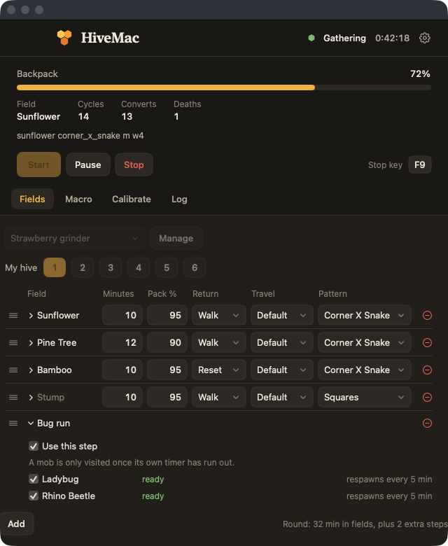
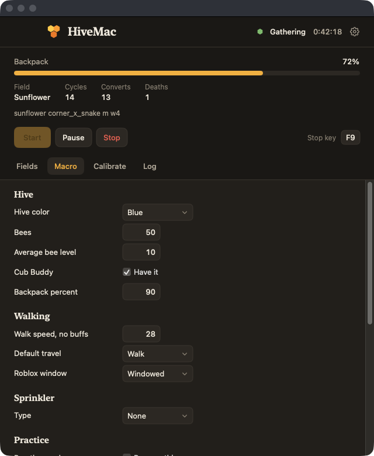

# HiveMac

[](https://github.com/jonathanbrantner/HiveMac/actions/workflows/check.yml)


**A small native macOS app that farms Bee Swarm Simulator for you.** Pick the fields, how long to
stay on each, and press Start. About 30 MB of memory, no Python, no extra installs.

<p align="center">
  
  
</p>

> **Beta.** The basics work in the real game: **gathering fields, mob runs (bug runs) and collecting
> things** (the wealth clock, dispensers, passes and boosters). Everything else is still in beta and
> being tested: planters, Mondo Chick and the other extras. Expect rough edges, and bug reports are welcome.
>
> **New and untested in the real game, so they may not work:** run modes (Booster mode and Quests),
> quests for Black Bear, Polar Bear, Brown Bear, Bucko Bee and Riley Bee, keeping the balloon blessing,
> the memory match, the reworked pickup routes (cannon and walking), and the Wealth clock in the modes.
> Quest objectives with petals, rage tokens, fire ants or tokens are skipped. Watch the first runs
> and keep your stop key ready.

## Read this first

- **It uses Natro Macro's open source route files.** The walks from the hive to each field and back
  are converted from [Natro Macro](https://github.com/NatroTeam/NatroMacro) (GPL-3.0). Thank you to
  the Natro team. See [NOTICE.md](NOTICE.md).
- **It is for macOS.** Natro is the Windows macro. HiveMac is a Mac app built the same way, not a port.
- **Automation is against Roblox's rules.** Accounts that use macros can be banned. Use it at your own
  risk, on an account you can afford to lose. HiveMac is not affiliated with Roblox or the game.

## What works today

| | |
|---|---|
| Fields | All 17 fields, each with its own minutes, backpack percent, pattern, size and sprinkler spot. Drag rows to reorder. |
| Runs | Save several named runs and switch between them. |
| Gathering loop | Reset to the hive, convert, walk to the field, gather until the backpack is full or time is up, walk back. |
| Screen reading | A few single pixels and small regions of the Roblox window: backpack bar, health bar, hive prompt. No full screen capture. |
| Stop key | One key (F9 by default) stops everything, even with Roblox in front. |
| Phone remote | Optional page on your Wi-Fi to start, pause and stop. |

**Saved but not run yet:** bug runs, planters, and the wealth clock and dispensers. You can set them up
in a run and HiveMac keeps their timers, but the macro does not carry them out yet. See
[docs/TODO.md](docs/TODO.md) for what is planned.

## Requirements

- macOS 14 or newer. Built and tested on Apple Silicon. Building from source needs Xcode 15 or newer.
- Roblox open, in a window or full screen (choose in the Macro tab). Camera mode Classic, movement
  mode Keyboard, low graphics set by hand, performance stats and micro profiler off, camera not
  inverted, English. Display colour profile sRGB, because the backpack reading expects it.
- In the game: the Red Cannon and the Glider (Mountain Top Shop, the upgrade of the Parachute) if you
  use cannon travel, and a sprinkler on your hotbar if you use one.

## Install

**Download (beta):** the [releases page](https://github.com/jonathanbrantner/HiveMac/releases) has a zip. It is not
notarized by Apple yet (that needs a paid developer account), so macOS can block it or even move it to the Trash as
"malware". It is not malware, but Apple has no way to know that. On a Mac you manage, building it yourself
(below) always works. On a school or work Mac the block comes from the owner's rules, so use your own Mac.

Build it yourself:

```sh
git clone https://github.com/jonathanbrantner/HiveMac.git
cd HiveMac/swift
scripts/make-app.sh
open build/HiveMac.app        # or copy it to /Applications
```

On the first run macOS asks for **Screen Recording** and **Accessibility**. The Settings tab shows their state.

**Keeping the permissions.** macOS ties them to how the app is signed. `make-app.sh` signs with your
Apple Development certificate when you have one (free with any Apple ID, create it in Xcode under
Settings, Accounts), and then the permissions stay through every update. Without one it signs ad hoc, and
macOS forgets the permissions after each build. If a permission shows as on but does nothing, use
Settings, More, Permissions, Reset and ask again.

## Quick start

1. Open Roblox and stand in your hive.
2. **Calibrate** tab: press **Detect Roblox**.
3. **Macro** tab: hive colour, walk speed without buffs, travel, sprinkler and hotbar. Press Save.
4. **Fields** tab: choose your hive slot (1 to 6) and the fields, then press **Start**.

## If something goes wrong

| Problem | Try this |
|---|---|
| "Roblox was not found" | Open Roblox first, then press Detect Roblox. Check the window or full screen choice in the Settings tab. |
| Start does nothing or stops at once | Turn on Screen Recording and Accessibility for HiveMac in System Settings, then reopen the app. |
| The character walks the wrong way | Check your hive slot on the Fields tab, and your walk speed without buffs in the Settings tab. |
| Resets fail or loop | Stand in your hive, press Detect Roblox again, and see More in Settings for the optional pictures. |
| Cannon travel fails | You need the Red Cannon and the Glider unlocked. Switch Default travel back to Walk to test. |

Still stuck? Open an issue. The template asks for the few details that help most.

## Uninstall

Quit HiveMac, delete `HiveMac.app`, and delete `~/Library/Application Support/HiveMac`. Then remove it
from the Privacy and Security lists in System Settings.

## For developers

```
swift/         the app (SwiftPM): HiveMacCore, HiveMacPlatform, HiveMacApp, tests
config/paths/  Natro's route files, converted (GPL-3.0 data)
tools/         the script that converted Natro's routes (only needed to redo that)
docs/          plans, research, live test checklist, TODO
```

```sh
cd swift && swift test
```

Work happens on `dev`. `main` takes pull requests once the checks pass.

## License

MIT for the HiveMac code. The route files in `config/paths/natro/` come from Natro Macro and stay
GPL-3.0. See [NOTICE.md](NOTICE.md).
